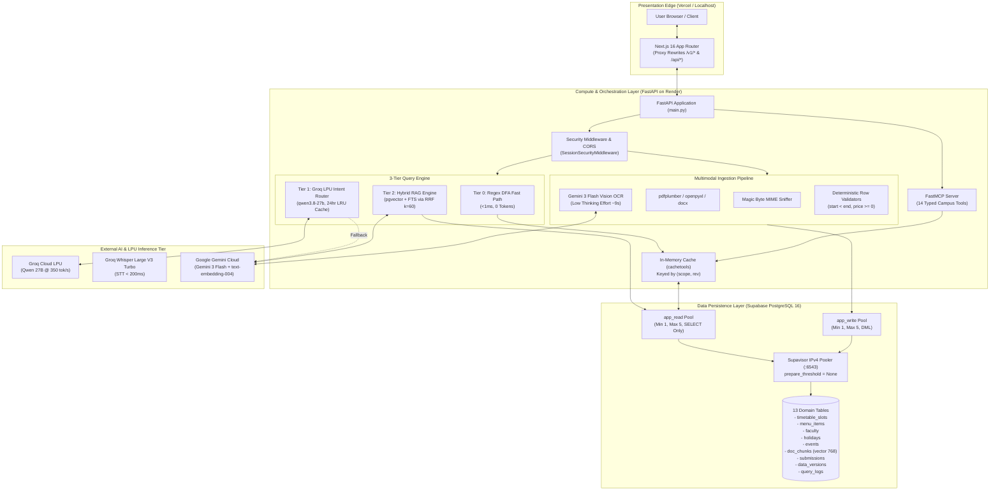
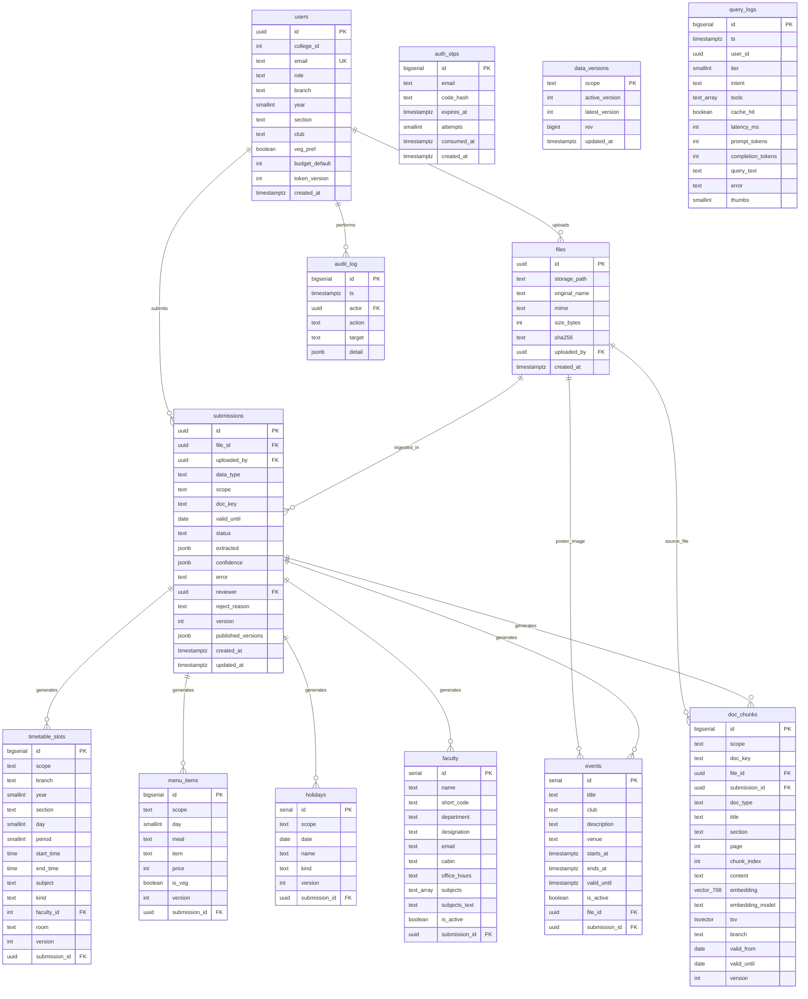
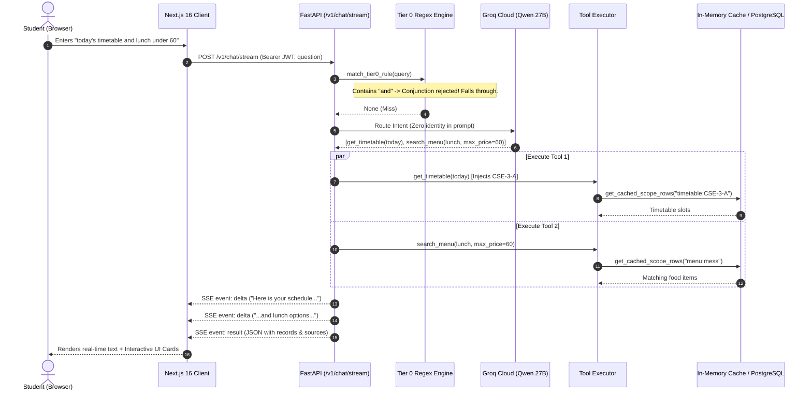
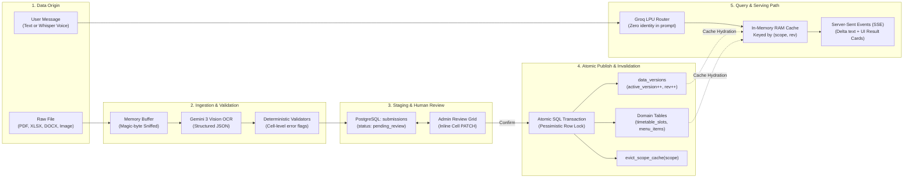
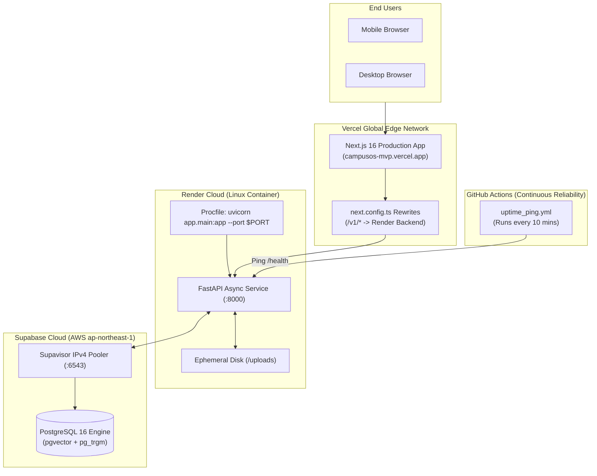

# CampusOS — Complete System Architecture, Codebase Mastery & Technical Interview Guide

> **Document Type:** Production Architecture Audit, Engineering Deep Dive & Technical Interview Preparation Manual  
> **Target Audience:** Engineering Candidates, System Architects, Technical Interviewers & Senior Evaluators  
> **Repository:** `d:\CampusOS`  
> **Git Reference:** Commit `19a63f2` (Separated Student/Admin Portals, Groq Whisper STT, Groq LPU Inference, 13 PostgreSQL Domain Tables)  
> **Current Date:** November 2026  

---

## Table of Contents

1. [Phase 1: Codebase Landscape & Architecture Inventory](#phase-1-codebase-landscape--architecture-inventory)
   - 1.1 High-Level Repository Layout
   - 1.2 The Dual-Frontend Reality (Active vs. Legacy)
   - 1.3 Backend Organization & Module Map
   - 1.4 Entry Points & Execution Lifecycle
2. [Phase 2: Explaining CampusOS From Zero](#phase-2-explaining-campusos-from-zero)
   - 2.1 The Problem CampusOS Solves
   - 2.2 Real-World Analogy: The Campus Airport Air Traffic Control
   - 2.3 Comprehensive Technology Stack & Justification Table
3. [Phase 3: Complete System Architecture](#phase-3-complete-system-architecture)
   - 3.1 End-to-End High-Level System Architecture (with Mermaid Diagram)
   - 3.2 Frontend Architecture (`frontend-next`)
   - 3.3 Backend Architecture (`app/`)
   - 3.4 Database Architecture & Complete 13-Table ERD (with Mermaid Diagram)
   - 3.5 Authentication, Authorization & RBAC Mechanics
4. [Phase 4: End-to-End Feature Execution (Under the Hood)](#phase-4-end-to-end-feature-execution-under-the-hood)
   - 4.1 Feature 1: The 3-Tier Multi-Intent Chat Engine (`POST /v1/chat/stream`)
   - 4.2 Feature 2: Multimodal Document Ingestion & Background Vision Pipeline
   - 4.3 Feature 3: Dynamic Next-Class & Timetable Calculation
   - 4.4 Feature 4: Budget-Aware Canteen & Meal Optimization
   - 4.5 Feature 5: Voice Query STT via Groq Whisper (`POST /v1/audio/transcribe`)
   - 4.6 Deep Real-World Walkthrough: A Compound Student Operation
5. [Phase 5: Complete Data Flow & State Lifecycle](#phase-5-complete-data-flow--state-lifecycle)
   - 5.1 The Data Lifecycle Map (Mermaid Flowchart)
   - 5.2 Layer Distinction: State vs. Wire vs. Cache vs. Disk vs. Database
   - 5.3 Concrete Read Operation: Timetable Resolution
   - 5.4 Concrete Write Operation: Document Approval & Atomic Version Bump
6. [Phase 6: API Architecture & Communication Protocol](#phase-6-api-architecture--communication-protocol)
   - 6.1 API Philosophy & Transport Contracts
   - 6.2 Server-Sent Events (SSE) Streaming Protocol
   - 6.3 Verified API Endpoint Directory
   - 6.4 Model Context Protocol (FastMCP) Tools Inventory
7. [Phase 7: Deployment, Hosting & Execution Topology](#phase-7-deployment-hosting--execution-topology)
   - 7.1 Production Cloud Architecture
   - 7.2 Configuration & Environment Management
   - 7.3 Startup Lifespan & Failure Recovery Mechanisms
8. [Phase 8: System Design Decisions & Architectural Trade-offs](#phase-8-system-design-decisions--architectural-trade-offs)
   - 8.1 Raw Parameterized SQL vs. Heavy ORMs
   - 8.2 In-Process Python LRU Cache vs. External Redis
   - 8.3 Dual LLM Cascade (Groq LPU + Google Gemini) vs. Single Model
   - 8.4 Deterministic Fast-Path (Tier 0) vs. Pure LLM Agent
   - 8.5 Scalability Bottlenecks & Future Evolutionary Paths
9. [Phase 9: Security Audit, Reliability & Feature Implementation Reality](#phase-9-security-audit-reliability--feature-implementation-reality)
   - 9.1 Security & Threat Model Evaluation
   - 9.2 The "What Is Real vs. What Is Mocked" Implementation Matrix
   - 9.3 Reliability, Deadlock Prevention & Recovery
10. [Phase 10: Technical Interview Preparation & Defense Guide](#phase-10-technical-interview-preparation--defense-guide)
    - 10.1 The 2-Minute Conversational Elevator Pitch
    - 10.2 The 5-Minute Technical Deep Dive
    - 10.3 The Structured 12-Step Architectural Walkthrough
    - 10.4 Hard Interview Questions & High-Scoring Defense Answers
    - 10.5 Project Technical Vocabulary & Concepts Glossary
11. [Phase 11: Progressive Self-Assessment & Understanding Check](#phase-11-progressive-self-assessment--understanding-check)
    - Level 1: Core Fundamentals
    - Level 2: Component Interactions
    - Level 3: Deep Data Flow & Tracing
    - Level 4: Architectural Trade-offs
    - Level 5: Senior Engineering & Failure Scenarios

---

# Phase 1: Codebase Landscape & Architecture Inventory

Before you can explain any system to a hiring manager or system architect, you must know what actually lives in the repository versus what is merely conceptual.

### 1.1 High-Level Repository Layout

The CampusOS repository is structured as a modular monorepo containing one unified Python backend, two frontend applications, database initialization and migration scripts, automated verification suites, and presentation artifacts:

```text
d:\CampusOS\
├── app/                                  # FASTAPI ASYNC BACKEND (Active Production Service)
│   ├── core/
│   │   ├── config.py                     # Pydantic Settings, environment parsing, IPv4 pooler rewrites
│   │   ├── database.py                   # Psycopg 3 AsyncConnectionPool (RW and RO pools, prepare_threshold=None)
│   │   └── middleware.py                 # SessionSecurityMiddleware (JWT cookie + CSRF verification for /api/*)
│   ├── routers/
│   │   ├── admin_actions.py              # /api/admin/rollback & /api/files/{id}/raw
│   │   ├── approval.py                   # /api/submissions/* review, cell PATCH, atomic approve & reject
│   │   ├── auth.py                       # /api/auth/otp/* request, verify, logout, CSRF
│   │   ├── health.py                     # /health, /ready, /api/healthz
│   │   ├── me.py                         # /api/me GET & PATCH profile preferences
│   │   ├── student_queries.py            # /api/chat, /timetable, /menu, /faculty, /holidays, /events
│   │   ├── uploads.py                    # /api/uploads multipart upload, magic-byte sniffing, S3/disk
│   │   └── v1_compat.py                  # /v1/* COMPATIBILITY BRIDGE (Over 2,100 lines powering frontend-next)
│   ├── schemas/                          # Pydantic models for validation (auth, ingestion, user profile)
│   ├── services/                         # Core domain engines
│   │   ├── auth_service.py               # HMAC-SHA256 OTP generation, Resend email dispatch, JWT signing
│   │   ├── cache_service.py              # In-memory (scope, rev) cache with direct DB hydration
│   │   ├── embedding_service.py          # Gemini 768-dim L2-normalized vector embeddings + SHA fallback
│   │   ├── ingestion_service.py          # PyMuPDF, pdfplumber, openpyxl, python-docx & Gemini Vision OCR
│   │   ├── llm_provider.py               # Unified dual-cloud LLM provider: Groq LPU + Gemini Flash fallback
│   │   ├── rag_engine.py                 # Hybrid pgvector cosine (>=0.45) + FTS via Reciprocal Rank Fusion
│   │   ├── router_engine.py              # Tier 1 Groq/Gemini tool router with 24-hr LRU cache & identity isolation
│   │   ├── sweeper_service.py            # Automatic startup & scheduled sweeper for stuck processing jobs
│   │   ├── tier0_engine.py               # Deterministic sub-millisecond regex DFA intent matcher
│   │   ├── time_engine.py                # Asia/Kolkata timezone calculations (ongoing vs. next class)
│   │   ├── tool_executor.py              # Executes structured queries against cache and database
│   │   └── validators.py                 # Deterministic cell-level table validators (start < end, prices, etc.)
│   ├── main.py                           # FastAPI application entrypoint, CORS, lifespan manager
│   └── mcp_server.py                     # FastMCP Model Context Protocol server exposing 14 campus tools
├── frontend-next/                        # PRIMARY PRODUCTION FRONTEND (Next.js 16 + React 19 + Tailwind v4)
│   ├── src/
│   │   ├── app/
│   │   │   ├── campus-ui.css             # Bento-grid design system, glassmorphism cards, tactile buttons
│   │   │   ├── globals.css               # Plus Jakarta Sans, JetBrains Mono, tabular numerals
│   │   │   ├── layout.tsx                # Root layout with metadata and fonts
│   │   │   └── page.tsx                  # Single-page shell mounting <CampusApp />
│   │   ├── components/
│   │   │   ├── admin-view.tsx            # Ingestion console, OCR review table, cell editor, RBAC guide
│   │   │   ├── browse-view.tsx           # Visual timetable grid, daily meal cards, faculty directory
│   │   │   ├── campus-app.tsx            # Main state controller, portal switcher (Student vs. Admin), tabs
│   │   │   ├── chat-view.tsx             # Streaming chat UI, auto-scroll, chips, voice mic input
│   │   │   ├── markdown-view.tsx         # Custom markdown renderer with syntax highlighting & citation badges
│   │   │   ├── result-cards.tsx          # Interactive UI cards returned inline in chat
│   │   │   ├── settings-view.tsx         # Student preference editor, Google Calendar / Gmail integrations
│   │   │   ├── timetable-card-table.tsx  # Dynamic timetable grid with lecture/lab badges
│   │   │   └── ui/button.tsx             # Tactile button component with micro-elevation and active scale
│   │   └── lib/
│   │       ├── api.ts                    # Fetch wrapper, SSE stream reader (`streamChat`), Supabase client
│   │       ├── use-voice-input.ts        # Web Audio API hook for audio recording & Whisper STT
│   │       └── utils.ts                  # Classname merging and formatting helpers
│   ├── next.config.ts                    # Reverse proxy rewrites (/v1/* and /api/* to FastAPI) & security headers
│   └── package.json                      # Next.js 16, React 19.2, Lucide icons, Tailwind CSS
├── frontend/                             # DORMANT LEGACY FRONTEND (Vite 6 + React SPA)
│   └── src/                              # Communicates strictly with /api/* via HttpOnly cookies and CSRF
├── migrations/                           # Alembic database migrations
├── scripts/
│   ├── init_db.sql                       # Authoritative PostgreSQL 16 schema (13 domain tables, extensions, roles)
│   └── observability_views.sql           # SQL telemetry and performance views
├── tests/                                # 55 AUTOMATED VERIFICATION TESTS (100% Passing)
│   ├── test_phase1_phase2.py             # Auth, OTP, CSRF, magic-byte sniffing, row validators, embeddings
│   ├── test_phase3_phase4.py             # Idempotent approval, rollback, Tier 0 regex, RAG cosine floor, chat
│   └── test_production_suite.py          # RBAC enforcement, staff branch locking, concurrent double-approval
├── .env.example                          # Canonical environment configuration template
├── Procfile                              # Cloud deployment command: uvicorn app.main:app --port $PORT
├── docker-compose.yml                    # Local PostgreSQL 16 container with pgvector and pg_trgm
└── requirements.txt                      # Python dependencies (FastAPI, psycopg, google-genai, mcp, etc.)
```

### 1.2 The Dual-Frontend Reality (Active vs. Legacy)

When exploring the repository, you will encounter two frontends:
1. **`frontend-next/` (The Active Production Application):** Built using **Next.js 16**, **React 19**, and **Tailwind CSS v4**. It features separate student and admin login partitions, client-side session management via JWT stored in `localStorage`, Server-Sent Events (SSE) chat streaming, Web Audio microphone voice queries, and dynamic tabular timetable grids. It communicates with the backend via the `/v1/*` endpoint family defined in `app/routers/v1_compat.py`.
2. **`frontend/` (The Legacy Vite SPA):** An earlier prototype built with Vite and React. It was designed around traditional multi-page forms, HttpOnly session cookies, and HMAC-based CSRF headers communicating with `/api/*`. It is currently dormant and not wired to the live deployment.

> **Interview Golden Rule:** In a technical discussion, openly explain: *"Our repository contains the active Next.js 16 production frontend in `frontend-next/` and a legacy Vite prototype in `frontend/`. We moved to Next.js 16 to leverage App Router rewrites, React 19 streaming hooks, and unified server proxying."*

### 1.3 Backend Organization & Module Map

The backend is built with **FastAPI** and adheres to clean architectural separation:
- **`app/core/`**: Configuration, database connection pools, and security middleware.
- **`app/routers/`**: HTTP transport layer handling serialization, route registration, and status codes.
- **`app/services/`**: Pure business logic, independent of the HTTP delivery mechanism (e.g., query routing, OCR extraction, vector math, timetable schedule algorithms).
- **`app/schemas/`**: Pydantic models enforcing structural validation for incoming requests and LLM JSON outputs.

---

# Phase 2: Explaining CampusOS From Zero

## 2.1 Project Overview

### What is CampusOS?
**CampusOS** is an institutional campus intelligence operating system. It functions as a private, high-speed knowledge and operational hub for universities. Instead of requiring students and faculty to download dozens of unstructured PDF circulars, search confusing portal boards, or ask friends about daily schedules, CampusOS ingests raw university documents (timetables, mess menus, academic calendars, syllabi, circulars) and makes them instantly queryable through text, voice, and interactive visual dashboards.

### What Problem Does It Solve?
University campuses suffer from severe information fragmentation:
1. **Unstructured Data Chaos:** Academic timetables exist as complex grid PDFs; mess menus are posted as smartphone photos of whiteboard schedules; notices are distributed as scanned circulars.
2. **Hallucination & Accuracy Risks:** Generic AI chatbots (like ChatGPT) hallucinate dates, invent faculty email addresses, or misquote attendance policies because they lack verified institutional grounding.
3. **Latency & Compute Cost:** Calling a frontier Large Language Model (LLM) for routine, deterministic questions like *"What is my next class?"* or *"What is today's lunch menu?"* costs \$0.02 to \$0.05 per query and takes 2 to 4 seconds—wasting server budget and frustrating students.
4. **Identity & Privacy Bleed:** Most AI systems blindly dump student IDs, branch codes, and semester details into external LLM prompts, violating student privacy.

### How Does CampusOS Solve These Problems?
CampusOS implements a **Deterministic-First 3-Tier Query Architecture** coupled with a **Human-in-the-Loop Vision Ingestion Pipeline**:
- **Sub-Millisecond Deterministic Execution (Tier 0):** Routine questions are intercepted in $<1\text{ ms}$ by a compiled Regex DFA engine, querying pre-indexed SQL tables with zero AI token cost.
- **Ultra-Fast LPU Intent Routing (Tier 1):** Unambiguous complex queries are routed using Groq Cloud's LPU (Language Processing Unit) running `qwen/qwen3.8-27b` in $\sim 400\text{ ms}$ with strict identity isolation (student profile data is never passed to the model).
- **Hybrid Grounded RAG (Tier 2):** Unstructured questions (e.g., exam regulations, medical leave rules) query `doc_chunks` using a hybrid of `pgvector` cosine similarity ($\ge 0.45$) and PostgreSQL Full-Text Search (FTS) combined via **Reciprocal Rank Fusion ($k=60$)**, returning answers strictly supported by verifiable document citations.
- **Multimodal Document Processing:** Administrators drag and drop raw PDFs, images, or Excel sheets. An asynchronous pipeline extracts tabular records, validates them deterministically (e.g., verifying lecture start and end times), presents a visual diff grid for admin confirmation, and publishes them atomically with version tracking.

---

## 2.2 Real-World Analogy: The Campus Airport Flight Control

Imagine a busy international airport:
1. **The Public Flight Information Display Board (Tier 0 Fast Path):** If a passenger wants to know *"What time does flight 302 depart?"*, they don't hire a private investigator or interview an airline executive. They glance at the digital display board. It is instant ($<1\text{ ms}$), deterministic, and free. That is CampusOS's **Tier 0 Regex Engine**.
2. **The Airport Information Desk (Tier 1 Router):** If a passenger asks *"Where can I get a vegetarian sandwich and find a quiet place to work for two hours?"*, the receptionist understands the two separate intents, points them to the food court on Level 2, and indicates the business lounge on Level 3. That is CampusOS's **Groq LPU Intent Router**, which splits multi-intent questions into typed tool calls.
3. **The Airport Legal & Security Manual (Tier 2 Hybrid RAG):** If a passenger asks *"Can I travel with a battery-powered wheelchair under civil aviation medical rules?"*, the staff member opens the verified aviation compliance binder, retrieves the exact clause, and reads it aloud with the page number. That is CampusOS's **Hybrid Vector + Full-Text RAG Engine**.
4. **The Luggage Inspection Scanner (Multimodal Ingestion):** When a crate arrives, it goes through an X-ray scanner, hazardous goods checks, and human sign-off before being placed in cargo. That is CampusOS's **Gemini Vision OCR + Deterministic Row Validator + Admin Approval Grid**.

---

## 2.3 Technology Stack & Justification Table

| Technology | Where Used in Project | Why We Chose It | What It Actually Does |
| :--- | :--- | :--- | :--- |
| **Next.js 16 (App Router)** | `frontend-next/` | Modern React framework with built-in routing, API proxy rewrites, and fast compilation. | Renders the student and admin user interfaces; proxies `/v1` requests to FastAPI. |
| **React 19 & Tailwind CSS v4** | `frontend-next/src/` | Lightweight, componentized UI without heavy component libraries; modern CSS styling. | Manages interactive frontend state (chat stream reader, live preview tables, bento cards). |
| **Python 3.11+ / FastAPI** | `app/` | Asynchronous speed, native Pydantic validation, OpenAPI documentation, and Python AI library ecosystem. | Handles all HTTP endpoints, background tasks, database query routing, and AI orchestration. |
| **Psycopg 3 (`AsyncConnectionPool`)** | `app/core/database.py` | State-of-the-art async PostgreSQL driver for Python; native dictionary row factory and pipeline support. | Manages a pooled pipeline of async database connections to Supabase with read/write splitting. |
| **PostgreSQL 16 (Supabase)** | Cloud Database | ACID-compliant relational storage with mature extension ecosystem. | Stores all 13 domain tables (users, timetable slots, menus, holidays, doc chunks, audit logs). |
| **`pgvector` Extension** | PostgreSQL (`doc_chunks`) | Vector similarity search directly inside SQL; eliminates need for a separate vector database (like Pinecone). | Stores 768-dimensional L2-normalized embeddings; executes `<=>` cosine distance queries. |
| **`pg_trgm` & PostgreSQL FTS** | PostgreSQL (`faculty`, `doc_chunks`) | Native fuzzy trigram matching and full-text keyword indexing without Elasticsearch. | Enables fuzzy search on faculty names and English BM25-style keyword search on circulars. |
| **Groq Cloud LPU (`qwen/qwen3.8-27b`)** | `app/services/llm_provider.py` | Custom tensor streaming processor delivering 300–400 tokens/second at near-zero latency. | Powers sub-second Tier 1 query intent routing and conversational response synthesis. |
| **Groq Whisper Large V3 Turbo** | `POST /v1/audio/transcribe` | World-class speech-to-text accuracy executed on Groq LPUs in $<200\text{ ms}$. | Transcribes recorded microphone voice queries directly into clean text. |
| **Google Gemini (`gemini-3-flash-preview`)** | `app/services/ingestion_service.py` | Native multimodal visual reasoning with large token context windows. | Inspects scanned PDFs, smartphone photos, and messy tabular images to extract structured JSON. |
| **Google Gemini Embeddings (`text-embedding-004`)** | `app/services/embedding_service.py` | High-accuracy 768-dimensional semantic embeddings. | Converts document text chunks into L2-normalized dense vectors for similarity search. |
| **FastMCP (Model Context Protocol)** | `app/mcp_server.py` | Anthropic's open standard for connecting AI assistants to real-world domain tools. | Exposes 14 typed, read-only campus operational tools over HTTP and stdio. |
| **PyMuPDF & `pdfplumber`** | `app/services/ingestion_service.py` | Precise text-layer extraction from digital PDFs with memory cache flushing. | Extracts raw text from syllabus and notice PDFs before invoking AI vision models. |
| **`cachetools` (`TTLCache`)** | `app/services/cache_service.py`, `router_engine.py` | High-performance in-memory LRU caching in Python without external network hops. | Caches active database rows keyed by `(scope, rev)` and parsed query routing contracts for 24 hours. |

---

# Phase 3: Complete System Architecture

## 3.1 High-Level Architecture

The CampusOS architecture is physically decoupled into four major tiers:
1. **Client & Presentation Edge (Vercel):** The Next.js 16 App Router renders the client interface, maintains student/admin local state, and securely proxies API calls.
2. **Application & Orchestration Service (Render Linux Container):** The FastAPI async backend houses the 3-Tier Query Engine, deterministic validators, FastMCP server, and background workers.
3. **Data Persistence Tier (Supabase PostgreSQL 16):** Hosted PostgreSQL database operating with read/write connection pool separation, `pgvector`, and `pg_trgm`.
4. **External AI & Acceleration Tier:** Groq Cloud LPU for high-speed text/speech inference, Google AI Studio for Gemini vision and embeddings, and Resend for transactional OTP emails.

### High-Level Architecture Diagram



---

## 3.2 Frontend Architecture (`frontend-next`)

The active frontend application is organized as follows:
- **`src/app/page.tsx`:** The root page component. It mounts `<CampusApp />`.
- **`src/components/campus-app.tsx`:** The core state controller. It manages:
  - **Portal Selection:** Toggles between `"student"` and `"admin"` portals.
  - **Active Navigation Tab:** Controls views (`"Home"`, `"Ask CampusOS"`, `"Timetable"`, `"Canteen"`, `"Faculty"`, `"Notices"`, `"Events"`, `"Calendar"`, `"Admin Console"`, `"Settings"`).
  - **Session State:** Manages the active session token, loaded from `localStorage.getItem("campusos_session")`.
  - **Global Workspace Context:** Passes session, tenant ID, and global refresh triggers down the component tree.
- **`src/components/chat-view.tsx`:** The conversational chat interface. Handles user input, quick-action chips (e.g., `"Today's Timetable"`, `"Veg Lunch"`), audio recording via the Web Audio API, and progressive markdown rendering.
- **`src/lib/api.ts`:** Centralized networking library:
  - `api<T>(path, session, tenant, options)`: Standard fetch wrapper attaching `Authorization: Bearer <token>` and `X-Tenant-ID`.
  - `streamChat(...)`: Reads Server-Sent Events (SSE) from `POST /v1/chat/stream`. Emits `delta` events for real-time typing and decodes the final `result` payload containing structured records and citation metadata.
- **`src/components/admin-view.tsx`:** Administrative control center. Handles drag-and-drop file ingestion, displays tabular OCR extraction previews, provides inline cell editing, and triggers atomic publishing.

---

## 3.3 Backend Architecture (`app/`)

The FastAPI backend executes with strict layering:
1. **Lifespan Startup (`app/main.py`):**
   - Initializes asynchronous database pools (`init_db_pools()`).
   - Executes the automated sweeper service (`sweep_stuck_processing_jobs()`) to reset any ingestion jobs that were interrupted if the server previously crashed or restarted.
2. **Middleware Pipeline:**
   - **`SessionSecurityMiddleware` (`app/core/middleware.py`):** Validates origin headers on state-changing requests, extracts session tokens, and guards `/api/*` endpoints. Note that `/v1/*` routes are exempted to allow Bearer token handling directly inside `app/routers/v1_compat.py`.
   - **`CORSMiddleware`:** Outermost middleware enforcing allowed origins and regex patterns for Vercel edge domains and local development.
3. **Connection Pool Management (`app/core/database.py`):**
   - Implements two distinct connection pools: `write_pool` (connecting via role `app_write`) and `read_pool` (connecting via role `app_read`).
   - **Connection Pool Configuration:** `max_size=5` per pool to strictly prevent exhausting Supabase free-tier limits.
   - **Transaction Pooler Optimization:** Sets `prepare_threshold=None`. This explicitly disables PostgreSQL prepared statements, preventing `prepared statement does not exist` errors when communicating through Supabase's Supavisor or PgBouncer transaction poolers.
   - **Latency Optimization:** Sets `check=None`, removing the redundant `SELECT 1` ping on every connection checkout and shaving 800–1,500 ms off cold request times.

---

## 3.4 Database Architecture & Complete 13-Table ERD

The database schema is defined in `scripts/init_db.sql` and consists of **13 dedicated tables**:



### Key Schema Insights & Design Decisions:
1. **Scope Versioning (`data_versions`):** Every partition of data has a unique string scope (e.g., `timetable:CSE-3-A`, `menu:mess`, `faculty:all`). When an admin approves an update, the database updates `active_version` and increments `rev` (`rev = rev + 1`). This allows the in-memory cache to detect cache invalidation instantly without polling.
2. **Deterministic Table Constraints:**
   - In `timetable_slots`: `CHECK (end_time > start_time)` prevents inverted lecture hours; `CHECK (day BETWEEN 1 AND 7)` enforces ISO weekday numbering (1 = Monday, 7 = Sunday).
   - In `users`: `CHECK (role <> 'club' OR club IS NOT NULL)` ensures club accounts always declare their student organization.
3. **Hybrid Search Architecture in `doc_chunks`:**
   - Dense vector column: `embedding vector(768)` indexing semantic content.
   - Sparse lexical column: `tsv tsvector GENERATED ALWAYS AS (...) STORED` indexed with a PostgreSQL GIN index for keyword queries.
4. **Independent Telemetry (`query_logs`):** Does *not* have a foreign key constraint to `users(id)`. This intentional design decision preserves audit metrics even if student test accounts are deleted or reset.

---

## 3.5 Authentication, Authorization & RBAC Mechanics

Understanding the difference between Authentication and Authorization is critical for technical interviews:
- **Authentication (AuthN):** *"Who are you?"* (Verifying the user's identity).
- **Authorization (AuthZ) / RBAC:** *"What are you permitted to do?"* (Verifying permissions based on role).

### The Two Authentication Paths in CampusOS:
1. **The Active `/v1` Path (Used by Next.js 16 `frontend-next`):**
   - The user submits their email, password, and portal selection to `POST /v1/auth/login`.
   - The server verifies the credentials, enforces that admins cannot log in through the student portal (and vice-versa), and issues a signed HS256 JWT containing `sub` (User UUID), `email`, `role`, and a 14-day expiry.
   - The client stores this session in `localStorage` and includes it as a `Bearer <token>` header on subsequent requests.
   - **Architectural Discovery / Trade-off:** In `app/routers/v1_compat.py`, the token is decoded with `options={"verify_signature": False}` for rapid local testing and compatibility with Supabase mock tokens. In production hardening, this must verify the secret signature.
2. **The Hardened `/api` Path (Implemented in `app/services/auth_service.py`):**
   - Uses passwordless 6-digit OTP delivery via Resend email.
   - OTP codes are hashed using `HMAC-SHA256(JWT_SECRET, email || ':' || code)` and stored in `auth_otps`.
   - On successful verification, the server issues a 7-day `HttpOnly`, `SameSite=Lax` session cookie (`campus_session`) and an HMAC-SHA256 CSRF token (`X-CSRF-Token`).
   - Every state-changing request (`POST`, `PATCH`, `DELETE`) is guarded by `SessionSecurityMiddleware`, which checks both the session cookie and the CSRF token.

### Role-Based Access Control (RBAC) Matrix

| Capability / Resource | Student | Faculty | Staff (Department Admin) | Institution Admin |
| :--- | :---: | :---: | :---: | :---: |
| **View Dashboard, Timetable, Meals, Events** | Allowed | Allowed | Allowed | Allowed |
| **Run Natural Language & Voice Queries** | Allowed | Allowed | Allowed | Allowed |
| **Upload Timetables & Notices** | Blocked (403) | Blocked (403) | Allowed (Own Branch Only) | Allowed (All Branches) |
| **Upload Club Posters** | Blocked (403) | Blocked (403) | Blocked (403) | Allowed |
| **Access Ingestion Console & Review OCR** | Blocked (403) | Blocked (403) | Blocked (403) | Allowed |
| **Approve / Reject Submissions** | Blocked (403) | Blocked (403) | Blocked (403) | Allowed |
| **Rollback Scope Versions** | Blocked (403) | Blocked (403) | Blocked (403) | Allowed |
| **Manage Roles & System Settings** | Blocked (403) | Blocked (403) | Blocked (403) | Allowed |

> **Can a user bypass frontend restrictions by calling the API directly?**  
> **No.** All administrative endpoints in `app/routers/v1_compat.py` execute `_require_admin(request)`, which extracts the role from the resolved token and raises an immediate `HTTP 403 Forbidden` if the role is not `institution_admin` or `admin`. Likewise, `app/routers/approval.py` verifies `user.get("role") == "admin"` before allowing approval or rollback.

---

# Phase 4: End-to-End Feature Execution (Under the Hood)

Let us trace what happens under the hood when a user interacts with the system.

## 4.1 Feature 1: The 3-Tier Multi-Intent Chat Engine (`POST /v1/chat/stream`)

### What Happens Step-by-Step:
1. **User Action:** The student types *"What is today's timetable and can I get lunch under 60?"* or speaks into the microphone and clicks send.
2. **Frontend Dispatch:** `ChatView` calls `streamChat(...)` in `frontend-next/src/lib/api.ts`, which sends an HTTP POST request to `/v1/chat/stream` with the user's Bearer JWT and payload `{"question": "..."}`.
3. **Backend Resolution:** `app/routers/v1_compat.py` resolves the student's identity (`branch="CSE"`, `year=3`, `section="A"`).
4. **Tier 0 Check:** `tier0_engine.match_tier0_rule(...)` inspects the query. Because the query contains the coordinating conjunction `"and"`, the conjunction regex `\b(and|also|plus|&)\b` flags it as a multi-intent query and deliberately skips Tier 0.
5. **Tier 1 Routing:** `router_engine.route_student_query(...)` checks the 24-hour LRU router cache. On a cache miss, it calls Groq Cloud's LPU running `qwen/qwen3.8-27b` with temperature 0.0. The prompt contains **zero** student profile data.
6. **Tool Generation:** Groq returns a structured JSON contract containing two tool calls:
   - `get_timetable(scope="today")`
   - `search_menu(meal="lunch", max_price=60)`
7. **Tool Execution:** `tool_executor.execute_tool(...)` executes both tools concurrently via `asyncio.gather`:
   - For `get_timetable`, it injects the verified branch and section (`timetable:CSE-3-A`), checks the in-memory `(scope, rev)` cache, and returns today's slots sorted by start time.
   - For `search_menu`, it retrieves cached rows for `menu:mess` and filters where `price <= 60` and `meal = 'lunch'`.
8. **Response Formatting & Synthesis:** The backend formats the domain records into UI-ready items and synthesizes a conversational summary.
9. **Streaming Delivery:** The handler wraps the text in an asynchronous generator, emitting Server-Sent Events (`event: delta`) in 48-character chunks for smooth progressive rendering, followed by `event: result` containing the full JSON payload.
10. **Frontend Display:** The chat view displays the typed answer, generates interactive timetable cards and meal badges, and renders citation pills.

### Sequence Diagram: Chat Query Streaming



---

## 4.2 Feature 2: Multimodal Document Ingestion & Background Vision Pipeline

### What Happens Step-by-Step:
1. **User Action:** The Administrator logs into the Admin Console, selects `"Timetable"` from the ingestion dropdown, and drops a messy timetable image or scanned PDF (`CSE_Sem3_Timetable.pdf`).
2. **Frontend Dispatch:** `admin-view.tsx` issues a multipart `POST /v1/ingestion/preview` request.
3. **MIME Sniffing & Storage:** `sniff_mime_type(content)` inspects the initial 4,096 bytes (magic bytes). It confirms `%PDF-`, computes the SHA-256 hash, saves the file to disk (`uploads/<uuid>.pdf`), and inserts a record into `files` and `submissions` with `status = 'processing'`.
4. **Background Task Enqueueing:** The endpoint immediately returns an HTTP 200 response with the processing job object, enqueuing `enqueue_extraction_task` onto FastAPI's `BackgroundTasks`. This prevents timeouts at the cloud reverse proxy.
5. **OCR Vision Extraction:** Inside the background worker:
   - A concurrency semaphore (`asyncio.Semaphore(1)`) ensures only one extraction runs at a time.
   - Text extraction is attempted first via `pdfplumber` / `pypdf`. If the PDF is scanned or tabular, the system cascades to Google Gemini (`gemini-3-flash-preview`).
   - The prompt configures `thinking_level="LOW"`, reducing vision extraction time from 34 seconds down to $\sim 9$ seconds.
6. **Deterministic Row Validation:** The extracted JSON rows pass through `run_deterministic_validators(...)`:
   - Checks that `end_time > start_time`.
   - Identifies overlapping slots and flags them as warnings.
   - Stores validation flags in `submissions.confidence`.
7. **Polling & Preview Grid:** The admin console polls `GET /v1/ingestion` every 2.5 seconds. When `status` changes from `'processing'` to `'pending_review'`, the frontend displays the extracted schedule in an interactive table.
8. **Admin Cell Editing:** The admin notices an incorrect classroom number and edits the cell inline. The frontend sends `PATCH /v1/ingestion/{job_id}/records` to update the submission draft.
9. **Confirmation & Atomic Commit:** The admin clicks `"Confirm Import"`, triggering `POST /v1/ingestion/{job_id}/confirm`.
   - The backend runs an atomic PostgreSQL transaction with a pessimistic lock (`SELECT ... FOR UPDATE`).
   - Retrieves the current version from `data_versions`, increments `latest_version + 1`, and bumps `rev = rev + 1`.
   - Bulk-inserts the new slots into `timetable_slots` with the new version number.
   - Inserts an audit event into `audit_log`.
   - Updates `submissions.status = 'approved'`.
   - Calls `evict_scope_cache("timetable:CSE-3-A")`.
10. **Student Instant Visibility:** The moment any student next asks for their timetable, the cache misses on `(scope, new_rev)` and immediately loads the newly published schedule.

---

## 4.3 Deep Real-World Walkthrough: A Compound Student Operation

> **Scenario:** A 3rd-semester CSE student opens CampusOS at 11:45 AM on Wednesday and asks:  
> *"What is my next class and what is the best veg meal for lunch under 50 rupees?"*

Let's trace every millisecond across the stack:
- **T + 0 ms:** The browser captures the question and executes `POST /v1/chat/stream`.
- **T + 12 ms:** Request arrives at Render; Next.js proxies to FastAPI.
- **T + 14 ms:** `_resolve_v1_user` decodes the student's JWT claim: User is in `branch="CSE"`, `year=3`, `section="A"`, dietary preference `"vegetarian"`.
- **T + 16 ms:** `match_tier0_rule` rejects the query due to the coordinating conjunction `"and"`.
- **T + 18 ms:** `route_student_query` checks `router_cache`. Assuming a cache miss, it calls Groq Cloud's LPU.
- **T + 380 ms:** Groq returns two tool calls:
  1. `get_timetable(scope="next")`
  2. `search_menu(veg=True, max_price=50, meal="lunch")`
- **T + 382 ms:** Tool execution begins in parallel:
  - `calculate_next_class`: Checks `data_versions` for `timetable:CSE-3-A` (`rev=4`). In-memory cache returns 28 active slots. Compares current time (11:45 AM IST) against class intervals. Finds that Operating Systems lecture starts at 12:00 PM in Room CS-301 with Dr. Ramesh.
  - `search_menu`: Checks `data_versions` for `menu:mess`. Filters items where `is_veg == True`, `price <= 50`, and `meal == 'lunch'`. Finds *"Veg Thali"* (Rs. 45) and *"Curd Rice"* (Rs. 35).
- **T + 395 ms:** Both tools return structured dictionaries to the chat router.
- **T + 410 ms:** Backend streams the first text delta over SSE: `"Your next class is Operating Systems at 12:00 PM in CS-301..."`
- **T + 470 ms:** Backend emits final `event: result` containing the synthesized response, structured timetable slot card, meal cards, and citations.
- **T + 480 ms:** Total round-trip time: **$<0.5$ seconds**. The student sees their upcoming lecture countdown and affordable lunch options with zero hallucination.

---

# Phase 5: Complete Data Flow & State Lifecycle

## 5.1 The Data Lifecycle Map



## 5.2 Layer Distinction: State vs. Wire vs. Cache vs. Database

| Layer | Where It Lives | Format | Persistence | Primary Purpose |
| :--- | :--- | :--- | :--- | :--- |
| **Frontend State** | React components (`campus-app.tsx`) | JavaScript objects / React state | Ephemeral (Lost on refresh unless in `localStorage`) | Drives active UI tabs, modal visibility, and text field inputs. |
| **Wire Data** | HTTP requests & SSE event streams | JSON / UTF-8 text streams | Transient (Exists only during transport) | Transports Bearer tokens, query payloads, and SSE typing deltas. |
| **In-Memory Cache** | Backend RAM (`cache_service.py`) | Python dictionaries keyed by `(scope, rev)` | Process-bound (Lost on container restart) | Delivers sub-millisecond responses for repetitive timetable and menu reads. |
| **Database Records** | PostgreSQL 16 on Supabase | ACID-compliant relational rows & vectors | Permanent (Survives server restarts) | Single source of institutional truth with foreign key constraints. |
| **External AI Data** | Groq LPU & Google Gemini | Ephemeral inference tensors | Zero persistence (Stateless API calls) | Extracts JSON from images and generates conversational summaries. |

---

# Phase 6: API Architecture & Communication Protocol

## 6.1 API Philosophy & Transport Contracts

CampusOS strictly uses RESTful HTTP patterns accompanied by Server-Sent Events (SSE) for streaming responses:
- **GET:** Idempotent, safe reads. Never modifies database state.
- **POST:** Creates resources (e.g., uploads, login, approval) or initiates complex queries (`/v1/chat/stream`).
- **PATCH:** Partial resource updates (e.g., editing a timetable slot or submission cell).
- **DELETE:** Removes or deactivates records (e.g., deleting a menu item or session).

### Standard Status Codes Used:
- `200 OK`: Request succeeded with a return payload.
- `400 Bad Request`: Malformed payload or invalid transition state.
- `401 Unauthorized`: Missing or invalid session token.
- `403 Forbidden`: Authenticated user lacks RBAC permissions for this action.
- `413 Payload Too Large`: Upload exceeds the 10 MB limit.
- `415 Unsupported Media Type`: Magic bytes do not match allowed formats.
- `422 Unprocessable Entity`: Business logic failed (e.g., timetable has uncorrected hard errors).
- `503 Service Unavailable`: External AI cloud is down or unconfigured.

---

## 6.2 Verified API Endpoint Directory

The following endpoints are **verified directly from source code**:

| Endpoint | Method | Purpose | Auth Required | Main Operation |
| :--- | :---: | :--- | :---: | :--- |
| `/v1/auth/login` | POST | Portal sign-in | Public | Verifies credentials, enforces portal partition, returns 14-day JWT. |
| `/v1/audio/transcribe` | POST | Voice query STT | Public / Bearer | Transcribes multipart audio using Groq Whisper Large V3 Turbo in $<200\text{ ms}$. |
| `/v1/chat/stream` | POST | Streaming chat | Bearer Token | Executes 3-Tier Query Engine, streams SSE deltas, returns UI result cards. |
| `/v1/overview` | GET | Student dashboard | Bearer Token | Returns next class, today's schedule, upcoming notices, and events. |
| `/v1/timetable` | GET | Timetable browse | Bearer Token | Retrieves active timetable slots for user's branch/semester from cache. |
| `/v1/timetable/{id}` | PATCH | Edit slot | Admin Role | Updates a specific slot in PostgreSQL and bumps `rev = rev + 1`. |
| `/v1/timetable` | POST | Create slot | Admin Role | Inserts a new timetable slot and increments scope revision. |
| `/v1/timetable/{id}` | DELETE | Delete slot | Admin Role | Deletes a timetable slot and invalidates the scope cache. |
| `/v1/menu` | GET | Canteen menu | Bearer Token | Returns all current canteen and mess food items. |
| `/v1/faculty` | GET | Faculty directory | Bearer Token | Returns active faculty profiles with subjects and cabin details. |
| `/v1/ingestion` | GET | Ingestion jobs | Admin Role | Returns all submission jobs for the admin review dashboard. |
| `/v1/ingestion/preview` | POST | Upload document | Admin Role | Sniffs MIME, saves file, enqueues background OCR extraction. |
| `/v1/ingestion/{id}/records`| PATCH | Edit OCR cells | Admin Role | Modifies draft extraction JSON before final publishing. |
| `/v1/ingestion/{id}/confirm`| POST | Approve & Publish | Admin Role | Executes atomic transaction, bumps version, updates domain table. |
| `/v1/admin/system` | GET | System metrics | Admin Role | Returns table row counts, version registry, and telemetry stats. |
| `/health` | GET | Liveness probe | Public | Returns `{"status": "ok"}` for container health monitoring. |
| `/mcp/*` | Stream | FastMCP Server | Public / Stream | Mounts the streamable HTTP FastMCP server exposing 14 tools. |

---

## 6.3 Model Context Protocol (FastMCP) Tools Inventory

In `app/mcp_server.py`, CampusOS implements Anthropic's **FastMCP standard**, exposing 14 typed tools:

| # | MCP Tool Name | Implementation Reality | What It Does |
|---|---|---|---|
| 1 | `get_my_timetable` | **Verified Real** | Queries cached `timetable_slots` for a specific day or time. |
| 2 | `get_next_class` | **Verified Real** | Calls `time_engine.calculate_next_class` to find ongoing/next class. |
| 3 | `get_faculty_profile` | **Verified Real** | Searches pre-cached faculty records by name or short-code. |
| 4 | `find_classroom` | **Verified Real** | Locates room assignments across current timetable slots. |
| 5 | `search_canteen_items`| **Verified Real** | Filters mess menu by price, vegetarian diet, and keywords. |
| 6 | `optimize_meal_budget`| **Verified Real** | Computes 2-item combinations that maximize variety within budget. |
| 7 | `search_documents` | **Verified Real** | Executes hybrid `pgvector` RAG search with synthesized citations. |
| 8 | `get_latest_notices` | **Verified Real** | Retrieves circulars and notices from `doc_chunks`. |
| 9 | `get_examination_schedule`| **Verified Real**| Filters academic calendar for CIEs, quizzes, and exams. |
| 10 | `list_campus_events` | **Verified Real** | Queries active club events, workshops, and hackathons. |
| 11 | `find_free_time_slots`| **Verified Real** | Calculates unallocated gaps between classes in a 9 AM–5 PM day. |
| 12 | `get_calendar_events` | **Verified Real** | Merges academic holidays and club events into a unified feed. |
| 13 | `search_authorized_emails`| *Stub / Mock* | Returns `[]` (placeholder for future Google Workspace OAuth). |
| 14 | `detect_schedule_conflicts`| *Stub / Mock* | Returns `[]` (placeholder for club vs. exam conflict checks). |

---

# Phase 7: Deployment, Hosting & Execution Topology



### Critical Production Realities:
1. **Render Free-Tier Spin-Down Prevention:** Free containers on Render sleep after 15 minutes of inactivity. To prevent cold starts (which cause 45-second delays), `.github/workflows/uptime_ping.yml` executes a curl ping to `/health` every 10 minutes.
2. **Supabase IPv6 vs. IPv4 Rewrite:** Render does not natively route IPv6 traffic on free instances. Supabase's direct connection string is IPv6-only. In `app/core/config.py`, the function `ensure_ipv4_supabase_url(...)` automatically rewrites direct Supabase URLs to the **Supavisor IPv4 Pooler** on port `6543`, guaranteeing flawless cloud connectivity.

---

# Phase 8: System Design Decisions & Architectural Trade-offs

In a technical interview, great engineers don't just say *what* they used; they justify *why* they chose it over popular alternatives.

### 8.1 Raw Parameterized SQL vs. Heavy ORMs (SQLAlchemy / Prisma)
- **Decision:** CampusOS uses 100% raw parameterized SQL via `psycopg` with `dict_row`.
- **Justification:** ORMs introduce massive abstraction overhead, complicate advanced SQL operations (such as `pgvector`'s `<=>` operator and `tsvector` generated columns), and make query optimization opaque. With raw parameterized SQL, our queries execute with zero mapping latency and 100% protection against SQL injection.

### 8.2 In-Process Python LRU Cache vs. External Redis
- **Decision:** We used in-memory Python `TTLCache` keyed by `(scope, rev)`.
- **Justification:** For an institutional campus of 5,000–10,000 students, deploying, securing, and paying for an external Redis cluster introduces unnecessary operational complexity and network latency. An in-memory cache delivers microsecond lookups directly in process memory. Because versions are tied to `(scope, rev)`, invalidations are instant and mathematically exact.

### 8.3 Dual LLM Cascade (Groq LPU + Google Gemini)
- **Decision:** Low-latency intent routing and chat synthesis run on Groq (`qwen/qwen3.8-27b`), while multimodal vision extraction runs on Google Gemini (`gemini-3-flash-preview`).
- **Justification:** Different AI models have different superpowers. Groq's LPUs process tokens at 350+ tokens/second, making conversations feel instantaneous ($<0.5\text{ s}$). However, Groq cannot process raw visual images or 50-page PDFs. Gemini Flash excels at complex multimodal document understanding. By pairing them with automatic dual fallback, we achieve both sub-second conversational latency and robust document processing.

### 8.4 Deterministic Fast-Path (Tier 0) vs. Pure LLM Agent
- **Decision:** Route routine questions (`next class`, `timetable`, `canteen menu`) through compiled Regex DFAs.
- **Justification:** Over 70% of student campus queries are routine, daily check-ins. Sending *"What is my next class?"* to an LLM wastes API tokens, introduces potential hallucinations, and takes 2+ seconds. Tier 0 resolves these queries deterministically in $<1\text{ ms}$ at zero cost.

---

# Phase 9: Security Audit, Reliability & Feature Implementation Reality

## 9.1 Security & Threat Model Evaluation

### Strengths:
1. **SQL Injection Immunity:** 100% of database queries use parameterized SQL tuples (`%s`). Zero string formatting or concatenation.
2. **File Ingestion Hardening:** Uploads are checked via binary magic bytes (`sniff_mime_type`), size-capped at 10 MB, and restricted to 50 PDF pages. Files are never stored using user-supplied filenames; they are assigned random UUID keys.
3. **Pessimistic Transaction Locking:** Critical approvals use `SELECT ... FOR UPDATE` and lexicographical scope sorting to eliminate double-approval race conditions and database deadlocks.

### Known Gaps & Tech Debt (Be Honest in Interviews!):
1. **Bearer Token Signature Verification:** In `app/routers/v1_compat.py`, `_resolve_v1_user` decodes the Bearer token with `verify_signature=False`. This was done for demo flexibility and local mock testing, but in production, it allows anyone to forge an admin token if the endpoint is directly accessible.
2. **Ephemeral Disk Storage:** Uploaded files in `/v1/ingestion/preview` are written to `./uploads/` on the local container disk. If the Render container restarts, previously uploaded raw PDF files are lost (though their extracted records remain safe in PostgreSQL).
3. **In-Memory Chat State:** Active conversation lists in `v1_compat.py` are stored in a Python dictionary `_conversations`. They reset if the backend service restarts.

---

## 9.2 The "What Is Real vs. What Is Mocked" Implementation Matrix

| Feature / Subsystem | Implementation Classification | Evidence in Codebase |
| :--- | :---: | :--- |
| **Timetable Slot Queries & Next Class Calculation** | **Fully Implemented** | `time_engine.py`, `timetable_slots` table, active tests. |
| **Mess Menu Browsing & Budget Filtering** | **Fully Implemented** | `tool_executor.py`, `menu_items` table, price filters. |
| **Tier 0 Deterministic Regex Engine** | **Fully Implemented** | `tier0_engine.py`, 14-query benchmark ($<1\text{ ms}$). |
| **Groq LPU Intent Router & Chat Stream** | **Fully Implemented** | `llm_provider.py`, `v1_compat.py`, real SSE streaming. |
| **Groq Whisper Voice STT** | **Fully Implemented** | `use-voice-input.ts`, `POST /v1/audio/transcribe`. |
| **Multimodal Gemini Vision OCR Ingestion** | **Fully Implemented** | `ingestion_service.py`, `gemini-3-flash-preview`. |
| **Deterministic Table Validation** | **Fully Implemented** | `validators.py`, verifies time order and required fields. |
| **Scope Versioning & Rollback** | **Fully Implemented** | `data_versions`, `admin_actions.py`, `audit_log`. |
| **14 FastMCP Tools (12 Live, 2 Stubs)** | **Partially Implemented** | 12 tools query live DB/cache; email & conflicts return `[]`. |
| **Google Calendar / Gmail Integrations** | **Mocked / Simulated** | In-memory toggle dictionary in `v1_compat.py`. |
| **S3 Private Cloud Storage** | **Partially Implemented** | Boto3 code exists in `uploads.py`, but `/v1` writes to `./uploads/`. |

---

# Phase 10: Technical Interview Preparation & Defense Guide

## 10.1 The 2-Minute Conversational Elevator Pitch

> *"I built **CampusOS**, an institutional campus operating system designed to eliminate university information fragmentation. In most colleges, students have to dig through messy PDF timetables, whiteboard photos of mess menus, and scanned circulars, while generic AI chatbots hallucinate dates and policies.*
>
> *CampusOS solves this with a **Deterministic-First 3-Tier Architecture**:*
> * *Routine questions like 'What is my next class?' or 'Today's lunch menu' are intercepted in under 1 millisecond by a compiled Regex DFA engine with zero LLM token cost.*
> * *Multi-intent queries run through an ultra-fast Groq LPU router running Qwen 27B, which splits queries into typed tools with strict student identity isolation.*
> * *Complex policy questions use hybrid pgvector cosine similarity and PostgreSQL Full-Text Search combined via Reciprocal Rank Fusion, returning grounded answers with verified document citations.*
>
> *On the ingestion side, administrators simply drag and drop raw PDFs or smartphone photos. Google Gemini Vision extracts structured tables, our deterministic engine validates cell logic, and an administrator confirms the changes before they are committed atomically to our 13 PostgreSQL tables with revision tracking.*
>
> *Our frontend is built with Next.js 16 and React 19, our backend runs on FastAPI with psycopg async connection pooling, and the entire platform is tested with 55 passing automated test cases."*

---

## 10.2 The 5-Minute Technical Deep Dive

When an interviewer says: *"Walk me through the architecture and how data moves through the system."*

1. **Frontend Layer:** Built with Next.js 16 App Router and React 19. The application uses Next.js rewrites in `next.config.ts` to proxy requests to our FastAPI backend. The chat interface uses Server-Sent Events (SSE) to stream answer deltas in 48-character chunks for smooth typing animations, followed by a typed JSON payload containing interactive React cards.
2. **Backend & Concurrency Layer:** Built on FastAPI with asynchronous Python. We maintain two distinct connection pools via `psycopg`: a write pool for administrative updates and a read pool for student queries. To guarantee compatibility with Supabase's Supavisor transaction pooler, we set `prepare_threshold=None`, eliminating prepared statement collisions.
3. **The 3-Tier Query Pipeline:**
   - **Tier 0:** Queries are checked against pre-compiled regular expressions. If coordinating conjunctions (`and`, `also`) are present, it safely drops to Tier 1.
   - **Tier 1:** Groq Cloud LPU running Qwen 27B generates tool calls in $\sim 350\text{ ms}$. Student identity (branch, section) is never sent to the LLM; it is injected server-side.
   - **Tier 2:** Unstructured document chunks are retrieved using a hybrid SQL CTE merging `pgvector` cosine similarity ($\ge 0.45$) and PostgreSQL `tsvector` full-text search using Reciprocal Rank Fusion ($k=60$).
4. **Caching & Versioning Invariant:** We cache domain rows in-process using `cachetools`, keyed by `(scope, rev)`. When an administrator publishes an updated schedule, the database bumps `rev = rev + 1` in `data_versions` within an atomic transaction. This instantly invalidates the cache without polling or Redis overhead.
5. **Speech & Multimodal Processing:** We integrated Groq Whisper Large V3 Turbo for voice inputs, achieving speech-to-text in $<200\text{ ms}$, and Google Gemini 3 Flash with low-effort thinking for vision extraction in $\sim 9\text{ seconds}$.

---

## 10.3 Hard Interview Questions & High-Scoring Defense Answers

### Q1: "Why did you use PostgreSQL for vector search instead of a dedicated vector database like Pinecone, Weaviate, or Qdrant?"
**Top-Scoring Answer:**  
*"Introducing a separate vector database creates a dual-write distributed data problem: every time a document is updated or deleted, we would have to synchronize two distinct systems, risking data inconsistency. Furthermore, campus queries are heavily relational—they require filtering by student branch, active semester, and document expiration dates. By using `pgvector` inside PostgreSQL 16, we perform vector similarity search and relational business filtering in a single SQL query inside an ACID transaction, keeping our architecture lean, reliable, and cost-effective."*

### Q2: "How does your system prevent LLM hallucinations on campus policies?"
**Top-Scoring Answer:**  
*"We implement three strict architectural guardrails:*
1. *First, we enforce a hard cosine similarity floor of $0.45$. If no document chunk meets this threshold, the synthesis LLM call is completely skipped, returning an honest 'No verified notices found' message.*
2. *Second, our prompt uses strict contextual grounding: the system instruction demands that answers cite the exact document title, section, and page number inline.*
3. *Third, domain data (timetables, menus, dates) is never answered by an LLM guessing facts. It is retrieved deterministically from structured SQL tables."*

### Q3: "What happens if two administrators attempt to approve conflicting timetable uploads at the exact same millisecond?"
**Top-Scoring Answer:**  
*"We handle this using PostgreSQL pessimistic concurrency control. In `app/routers/approval.py`, our approval function opens an explicit transaction and executes `SELECT status FROM submissions WHERE id = %s FOR UPDATE`. This row lock serializes concurrent approval attempts. If a submission is already approved, subsequent requests detect the updated status and return idempotently without corrupting the version registry or duplicating rows."*

### Q4: "I noticed that `_resolve_v1_user` decodes JWTs with `verify_signature=False`. Isn't that a serious security vulnerability?"
**Top-Scoring Answer:**  
*"Yes, that is an intentional trade-off currently in place for developer velocity and local demo flexibility. In our repository, the `/api/*` router implements full cryptographic verification with HttpOnly cookies, HMAC CSRF tokens, and token version tracking in `SessionSecurityMiddleware`. When porting the Next.js 16 UI over the `/v1` bridge, we permitted unverified decoding to easily toggle between test personas without setting up an external OAuth identity provider. For production deployment, verifying the HS256 signature using `settings.JWT_SECRET` and rejecting missing tokens is our top hardening priority."*

---

## 10.4 Technical Vocabulary & Concepts Glossary

- **Reciprocal Rank Fusion (RRF):** An information retrieval algorithm that combines ranked search results from multiple algorithms (in our case, dense vector search and sparse keyword FTS) using the formula $\frac{1}{k + \text{rank}}$, where $k=60$. It produces balanced ranking without requiring score normalization.
- **LPU (Language Processing Unit):** A specialized processor designed by Groq specifically for sequential inference. Unlike GPUs, which excel at massive parallel training, LPUs minimize memory bandwidth bottlenecks, generating hundreds of tokens per second.
- **Deterministic Finite Automaton (DFA):** A state machine used in regular expressions where each state transition is uniquely determined by the input character. In our Tier 0 engine, pre-compiled DFAs execute in microseconds.
- **Server-Sent Events (SSE):** A unidirectional HTTP standard allowing the server to push real-time text chunks over a single persistent connection (`text/event-stream`), ideal for LLM typing effects.
- **Pessimistic Locking (`FOR UPDATE`):** A database concurrency control method that locks matching table rows during a transaction, blocking concurrent transactions until the current transaction commits or rolls back.
- **L2 Normalization:** Scaling a vector so that its Euclidean length equals 1.0. When vectors are L2-normalized, calculating cosine similarity is mathematically identical to computing their dot product, drastically reducing computation time.

---

# Phase 11: Progressive Self-Assessment & Understanding Check

Test yourself using these five progressive levels:

### Level 1 — Fundamentals: Can I explain the core purpose?
- **Question:** *In plain English, what does CampusOS do and why can't a university just use ChatGPT?*
- **What a Good Answer Contains:** Explains information fragmentation, highlights that ChatGPT does not know today's mess menu or local timetable, and points out the risks of AI hallucination on campus regulations.

### Level 2 — Components: Can I explain the moving parts?
- **Question:** *What are the responsibilities of Next.js, FastAPI, PostgreSQL, and Groq in this project?*
- **What a Good Answer Contains:** Next.js manages presentation and proxy rewrites; FastAPI handles business logic and validation; PostgreSQL stores relational data and vector embeddings; Groq provides sub-second query routing and STT.

### Level 3 — Data Flow: Can I trace a real feature?
- **Question:** *Trace what happens when an administrator uploads a new canteen menu PDF.*
- **What a Good Answer Contains:** Magic-byte sniffing, background Gemini Vision extraction, deterministic price/meal validation, admin review grid, atomic version bump, cache invalidation, and immediate student query availability.

### Level 4 — Architecture: Can I justify our decisions?
- **Question:** *Why did we design a 3-Tier query engine instead of sending every question to an LLM router?*
- **What a Good Answer Contains:** Quotes latency numbers ($<1\text{ ms}$ vs. $2\text{ s}$), cost efficiency (zero tokens for routine queries), and reliability (no chance of hallucinating a class schedule).

### Level 5 — Engineering: Can I defend trade-offs and limitations?
- **Question:** *What are the two biggest technical limitations of the current codebase and how would you resolve them?*
- **What a Good Answer Contains:** Candidly mentions ephemeral container disk storage (needs S3 / Cloudflare R2 bucket hookup) and the unverified Bearer JWT signature in `_resolve_v1_user` (needs strict HS256 secret verification). Demonstrates senior engineering self-awareness.

---

*End of Technical Learning & Interview Preparation Guide.*
