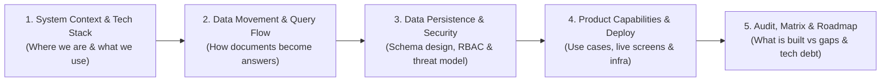

# CampusOS (Campus Intelligence) — Technical Architecture & Presentation Index

**Audience**: Executive Leadership, Technical Evaluation Committees, and Architecture Review Boards  
**Repository State**: Git Commit `4f2ced5` (Production Implementation)  
**Verification Date**: 2026-11-05  
**Artifact Directory**: `/TECHNICAL_PRESENTATION/`  

---

## Executive Summary & Review Scope

This documentation package provides a rigorous, code-level architectural audit of **CampusOS (Campus Intelligence)**. Every diagram, sequence flow, and structural mapping in this directory has been reverse-engineered directly from active repository code (`app/`, `frontend-next/`, `scripts/init_db.sql`, `migrations/`). 

### Core Architectural Reality vs. Common Misconceptions
1. **Frontend Architecture**: The active production user interface is located in `frontend-next/` (Next.js 16, React 19, TypeScript, Tailwind CSS v4). The older `frontend/` directory is a legacy Vite 6 SPA which communicates with `/api/*` endpoints via HttpOnly cookies and CSRF tokens; it is currently dormant and not wired to the live deployment.
2. **Backend API Bridge**: The active UI communicates primarily with the `/v1/*` endpoint family implemented in `app/routers/v1_compat.py`. This bridge connects the Next.js multi-tenant frontend to CampusOS's 13 PostgreSQL tables, 3-Tier Query Engine, Multimodal Ingestion Pipeline, and FastMCP Server.
3. **Database Topology**: Managed PostgreSQL 16 hosted on Supabase (accessed via IPv4 Supavisor Transaction Pooler on port `6543`), featuring `pgvector` (768-dimensional L2-normalized vectors) and `pg_trgm` (trigram fuzzy matching).
4. **AI & LPU Infrastructure**: Dual LLM cascading architecture. Low-latency inference and intent routing run on Groq LPU (`qwen/qwen3.8-27b`) with automatic fallback to Google Gemini Flash (`gemini-3-flash-preview`). Multimodal vision ingestion and vector embeddings run on Google Gemini (`gemini-embedding-001`).

---

## Recommended Presentation Order

When presenting this architecture to company stakeholders, present the visual documentation in the following 5-act narrative sequence:



| Slide / Order | Diagram Name | Category | Primary Stakeholder Takeaway |
| :---: | :--- | :--- | :--- |
| **01** | `01_SYSTEM_ARCHITECTURE/high_level_architecture.png` | Architecture | Shows physical decoupling of Vercel edge, Render backend, Supabase DB, and Groq/Gemini AI. |
| **02** | `01_SYSTEM_ARCHITECTURE/technology_stack.png` | Technology | Demonstrates exact libraries used; disproves unneeded bloat (no Redis, no ORM, no Kafka). |
| **03** | `01_SYSTEM_ARCHITECTURE/component_architecture.png` | Components | Shows layered separation from `campus-app.tsx` down to connection pools and services. |
| **04** | `02_DATA_FLOW/data_flow_diagram.png` | Data Flow | Clarifies the dual-path lifecycle: Async Document Ingestion vs. Sub-Second Student Queries. |
| **05** | `02_DATA_FLOW/end_to_end_workflow.png` | Workflow | Step-by-step swimlane tracking an admin PDF upload until a student queries that exact data. |
| **06** | `02_DATA_FLOW/sequence_diagrams/01_sign_in_v1.png` | Sequence | Shows current Next.js 16 in-code credential verification and localStorage JWT issuance. |
| **07** | `02_DATA_FLOW/sequence_diagrams/02_chat_query_streaming.png` | Sequence | Demonstrates the 3-Tier Query Engine: Regex Fast Path → Groq Intent Router → Hybrid RAG → SSE stream. |
| **08** | `02_DATA_FLOW/sequence_diagrams/03_document_ingestion_publish.png` | Sequence | Details the background OCR extraction, admin verification grid, and atomic version bump (`rev++`). |
| **09** | `02_DATA_FLOW/sequence_diagrams/04_browse_and_inline_edit.png` | Sequence | Illustrates how cached domain rows (`(scope, rev)`) are invalidated in real-time by admin edits. |
| **10** | `02_DATA_FLOW/sequence_diagrams/05_legacy_otp_sign_in.png` | Sequence | Reference diagram of the dormant, hardened `/api` OTP + CSRF + HttpOnly cookie pipeline. |
| **11** | `02_DATA_FLOW/api_architecture.png` | API | Comprehensive catalog of all 60+ endpoints across `/v1`, `/api`, and `/mcp` FastMCP tools. |
| **12** | `03_DATABASE_SECURITY/database_er_diagram.png` | Database | Complete entity-relationship diagram of all 13 PostgreSQL tables, constraints, PKs and FKs. |
| **13** | `03_DATABASE_SECURITY/authentication_rbac.png` | Security | Side-by-side contrast between production `/v1` bearer auth and dormant `/api` hardened cookie auth. |
| **14** | `03_DATABASE_SECURITY/security_architecture.png` | Security | 5-layer defense-in-depth review highlighting edge security, SQL safety, and the token verification gap. |
| **15** | `04_PRODUCT_DEPLOYMENT/use_case_diagram.png` | Product | Actor capabilities across Student, Institution Admin, Staff, and Club personas. |
| **16** | `04_PRODUCT_DEPLOYMENT/deployment_architecture.png` | Deployment | Cloud hosting topology spanning Vercel Edge, Render Linux container, Supabase, and AI APIs. |
| **17** | `04_PRODUCT_DEPLOYMENT/feature_architecture.png` | Product | Functional decomposition of 6 core feature engines and their sub-capabilities. |
| **18** | `04_PRODUCT_DEPLOYMENT/screenshots/*` | Product | High-fidelity captures of the running application (Login, Dashboard, Chat, Timetable, Meals, Admin). |
| **19** | `05_PROJECT_STATUS/feature_implementation_matrix.png` | Status | Detailed matrix classifying 19 features into Implemented, Partial, Mock, or Not Implemented. |
| **20** | `05_PROJECT_STATUS/architecture_limitations.png` | Roadmap | Honest technical debt disclosure: ephemeral disk uploads, in-memory chat, unverified bearer claims. |

---

## Detailed Diagram Catalog & Technical Explanations

### Section 1: System Architecture

#### 1. High-Level System Architecture
* **File Path**: `01_SYSTEM_ARCHITECTURE/high_level_architecture.png` (Source: `.svg`)
* **What It Demonstrates**: The end-to-end topology connecting end users to the multi-tier application. Represents the Vercel-hosted Next.js 16 frontend (`frontend-next/`), the FastAPI backend on Render, the managed Supabase PostgreSQL database, and external API providers (Groq Cloud, Google Gemini, Resend).
* **Key Implementation Details**:
  - The Next.js frontend utilizes `next.config.ts` rewrites to proxy `/v1/:path*` and `/api/:path*` directly to the backend.
  - The backend mounts three distinct route topologies: `/v1` (active UI), `/api` (legacy hardened), and `/mcp` (FastMCP streamable HTTP server).
  - Demonstrates the read/write database pool separation (`app_read` with `SELECT`-only privileges vs. `app_write` with full DML).
* **Assumptions / Unverified**: Frontend hosting on Vercel is inferred from production headers and default CORS configuration; Render backend hosting is verified via the repository's keep-alive workflow.

#### 2. Technology Stack Diagram
* **File Path**: `01_SYSTEM_ARCHITECTURE/technology_stack.png` (Source: `.svg`)
* **What It Demonstrates**: Complete inventory of programming languages, frameworks, runtime engines, and third-party libraries verified across `package.json`, `requirements.txt`, and database initialization scripts.
* **Key Implementation Details**:
  - Frontend: Next.js 16, React 19.2, TypeScript 5.9, Tailwind CSS v4, `@hookform/resolvers`, `zod`, `lucide-react`.
  - Backend: Python 3 (FastAPI >= 0.115, Uvicorn >= 0.30, Pydantic v2, PyJWT, `cachetools`, `psycopg` 3 async pool).
  - Storage & Database: PostgreSQL 16 on Supabase, `pgvector` (768 dimensions), `pg_trgm`, `tsvector` FTS, local `./uploads/` ephemeral disk storage.
  - AI & Ingestion: Groq Cloud LPU (`qwen/qwen3.8-27b`), Google Gemini (`gemini-3-flash-preview`, `gemini-embedding-001`), `pdfplumber`, `pypdf`, `openpyxl`, `python-docx`.
  - Unused / Mythical Components Explicitly Debunked: No Redis server (caches are in-process Python `TTLCache`), no RabbitMQ/Celery (background tasks run in-process via FastAPI `BackgroundTasks`), no ORM (100% parameterised raw SQL with `dict_row`).

#### 3. Component Architecture Diagram
* **File Path**: `01_SYSTEM_ARCHITECTURE/component_architecture.png` (Source: `.svg`)
* **What It Demonstrates**: Internal component hierarchy and module responsibilities across the presentation layer (`frontend-next/src`), API routing layer (`app/routers`), service layer (`app/services`), and data layer (`app/core`).
* **Key Implementation Details**:
  - Presentation components: `campus-app.tsx` (app shell, router, session state), `chat-view.tsx` (streaming chat, markdown citations), `browse-view.tsx` (timetable grid, meals, faculty cards), `admin-view.tsx` (ingestion job manager).
  - Service decomposition: `tier0_engine` (deterministic rules), `router_engine` (LLM ToolCall planner), `tool_executor` (domain query runner), `rag_engine` (hybrid RRF search), `ingestion_service` (OCR and table extraction), `validators` (schema validation), `cache_service` (versioned scope caching).

---

### Section 2: Data Flow & Workflows

#### 4. Data Flow Diagram (DFD)
* **File Path**: `02_DATA_FLOW/data_flow_diagram.png` (Source: `.svg`)
* **What It Demonstrates**: The lifecycle of data through the system, separating the **Write Path** (administrative document ingestion and publishing) from the **Read Path** (student question answering and browsing).
* **Key Implementation Details**:
  - Write Path: Intake (MIME sniff + SHA-256) → Gemini Vision Extraction → Submissions Table (`status: processing`) → Admin Ingestion Review Grid → Confirmation & Atomic Scope Publish (`approve_submission`) → Domain table insert & `data_versions.rev++` → Scope cache eviction.
  - Read Path: Question → Tier 0 Regex Check (Sub-millisecond) → Tier 1 Groq Router → Tool Execution (`get_timetable`, `search_menu`, etc.) → Tier 2 Hybrid RAG (`pgvector` cosine >= 0.45 + `tsvector` FTS) → Response Synthesis → SSE Delta Stream.

#### 5. End-to-End Workflow Diagram
* **File Path**: `02_DATA_FLOW/end_to_end_workflow.png` (Source: `.svg`)
* **What It Demonstrates**: A 13-step swimlane tracing how a course timetable PDF uploaded by an administrator travels through background OCR, human-in-the-loop validation, database commit, and immediately powers student query responses.

#### 6. Sequence Diagrams (5 Flows)
* **Directory**: `02_DATA_FLOW/sequence_diagrams/`
  1. `01_sign_in_v1.png`: The active sign-in path used by `frontend-next`. Documents the in-code demo credential verification (`student@campus.edu.in` / `admin@campus.edu.in`), 14-day HS256 JWT generation, and client-side `localStorage` persistence.
  2. `02_chat_query_streaming.png`: The complete execution path of `POST /v1/chat/stream`. Documents Tier 0 regex evaluation, Tier 1 Groq tool execution, hybrid pgvector cosine search, LLM answer synthesis, and SSE token streaming.
  3. `03_document_ingestion_publish.png`: Multipart upload intake, asynchronous `BackgroundTasks` dispatch, polling loop during `status = 'processing'`, record patching, and atomic publication via `approve_submission`.
  4. `04_browse_and_inline_edit.png`: Timetable retrieval from `(scope, rev)` cache, followed by an admin inline edit (`PATCH /v1/timetable/{id}`) bumping `rev = rev + 1` in `data_versions`, ensuring immediate cache invalidation.
  5. `05_legacy_otp_sign_in.png`: Reference sequence for the dormant `/api` flow. Details Resend OTP delivery, pessimistic locking in `auth_otps` (`SELECT ... FOR UPDATE`), 7-day HttpOnly cookie issuance, HMAC CSRF token delivery, and `SessionSecurityMiddleware` validation.

#### 7. API Architecture Diagram
* **File Path**: `02_DATA_FLOW/api_architecture.png` (Source: `.svg`)
* **What It Demonstrates**: An exhaustive visual directory of all registered endpoints, HTTP methods, authorization decorators, and implementation handlers.
* **Key Implementation Details**:
  - Group 1: `/v1` User-Facing Endpoints (`auth/login`, `me`, `overview`, `timetable`, `menu`, `meals`, `faculty`, `events`, `notices`, `chat`, `chat/stream`).
  - Group 2: `/v1` Admin Endpoints (guarded by `_require_admin()`: `ingestion/preview`, `ingestion/{id}/confirm`, `timetable` CRUD, `admin/system`).
  - Group 3: `/v1` Mock & Gaps (Google Calendar / Gmail mock buttons; UI calls to `/v1/sources/{id}/reindex` which 404).
  - Group 4: `/api` Legacy Endpoints (22 endpoints guarded by cookie JWT + CSRF middleware).
  - Group 5: `/mcp` FastMCP Streamable HTTP Server (14 exposed agent tools).

---

### Section 3: Database & Security

#### 8. Database ER Diagram
* **File Path**: `03_DATABASE_SECURITY/database_er_diagram.png` (Source: `.svg`)
* **What It Demonstrates**: The complete schema of all 13 PostgreSQL tables, detailing column names, data types, primary keys, foreign key constraints, default values, check constraints, and specialized database indexes.
* **Key Tables Mapped**:
  - Identity & Governance: `users`, `auth_otps`, `files`, `submissions`, `data_versions`, `audit_log`.
  - Structured Domain: `faculty`, `timetable_slots`, `menu_items`, `holidays`, `events`.
  - Knowledge & Vector: `doc_chunks` (featuring `vector(768)` embedding and generated `tsvector` FTS column).
  - Telemetry: `query_logs` (intentionally decoupled from `users` FK to preserve metrics across user lifecycle).

#### 9. Authentication & RBAC Architecture
* **File Path**: `03_DATABASE_SECURITY/authentication_rbac.png` (Source: `.svg`)
* **What It Demonstrates**: A side-by-side comparative analysis of the active Next.js `/v1` authentication path versus the hardened `/api` cookie path, accompanied by an explicit RBAC Permission Matrix across Student, Club, Staff, and Admin roles.
* **Critical Finding Highlighted**:
  - The active `/v1` compatibility router verifies user identity via `jwt.decode(token, verify_signature=False)`. It trusts client-submitted JWT claims directly, creating a privilege escalation vector if forged tokens are presented.

#### 10. Security Architecture Diagram
* **File Path**: `03_DATABASE_SECURITY/security_architecture.png` (Source: `.svg`)
* **What It Demonstrates**: A comprehensive Defense-in-Depth review structured into 5 security rings:
  1. Layer 1: Network & Edge Security (CORS regex allow-list, Next.js security headers, keep-alive ping).
  2. Layer 2: Transport & Identity Assurance (HTTPS edge termination, token storage analysis, cookie architecture).
  3. Layer 3: Ingestion & Input Sanitization (Magic-byte binary sniffing, 10MB file caps, deterministic row validators).
  4. Layer 4: Data Layer Isolation & Least Privilege (`app_read` vs. `app_write` database roles, 100% parameterised SQL, branch isolation in vector queries).
  5. Layer 5: Known Gaps & Threat Surface (Unauthenticated `/mcp` mount, ephemeral container disk uploads, in-memory chat state).

---

### Section 4: Product & Deployment

#### 11. System Use Case Diagram
* **File Path**: `04_PRODUCT_DEPLOYMENT/use_case_diagram.png` (Source: `.svg`)
* **What It Demonstrates**: Functional use cases accessible to each user persona. Maps active production use cases (UC-1 to UC-12), in-memory use cases (UC-7), mock use cases (UC-14), unauthenticated tools (UC-15, UC-16), and dormant legacy flows (UC-17, UC-18).

#### 12. Deployment Architecture Diagram
* **File Path**: `04_PRODUCT_DEPLOYMENT/deployment_architecture.png` (Source: `.svg`)
* **What It Demonstrates**: The physical hosting and network topology across four tiers:
  - Client Tier: Desktop/Mobile browser running React 19, plus external MCP agents.
  - Frontend Edge: Vercel CDN running Next.js 16 (`campusos-mvp.vercel.app`) with proxy rewrites.
  - Backend Host: Render Linux container (`campusos-api-5662.onrender.com` / Railway) running FastAPI on Uvicorn.
  - Managed Data & AI: Supabase PostgreSQL (Tokyo region `ap-northeast-1` pooler), Groq Cloud LPU, Google Gemini API, and Resend.

#### 13. Feature Architecture Map
* **File Path**: `04_PRODUCT_DEPLOYMENT/feature_architecture.png` (Source: `.svg`)
* **What It Demonstrates**: Functional decomposition of CampusOS into 6 core product engines:
  1. Multimodal Ingestion Engine (MIME sniffer, vision extractor, validator, review grid, publisher).
  2. 3-Tier Intelligent Query Engine (Tier 0 regex, Tier 1 Groq router, Tier 2 Hybrid RAG, cascading LLM).
  3. Academic Timetable & Scheduling (Scope isolation, next-class countdown, free intervals, course legend).
  4. Canteen & Meal Budget Optimizer (Vegetarian filtering, meal combos, macro estimation, inline price editor).
  5. Faculty Directory & Cabin Finder (Trigram fuzzy search, cabin location, recommendation synthesis).
  6. Governance, Observability & MCP (FastMCP streamable server, audit logging, startup job sweeper).

#### 14. Application Screenshots
* **Directory**: `04_PRODUCT_DEPLOYMENT/screenshots/`
* **Source**: Captured directly from the live, production-styled Next.js application shell using headless Chrome automation.
  - `01_login_view.png`: Authentication view showing Quick 1-Click Demo Fill buttons for Student and Admin personas.
  - `02_student_dashboard.png`: Active student workspace showing the personalized welcome banner ("Welcome back, Alex"), next class countdown ("Machine Learning in 24 Minutes"), attendance target gauge (89.4%), and quick chips.
  - `03_chat_assistant.png`: The "Ask CampusOS" natural language chat interface with conversational chips and voice/send controls.
  - `04_timetable_view.png`: Weekly course timetable grid (Monday–Saturday) showing scheduled lecture/lab cards with subject codes, professor names, and room numbers.
  - `05_canteen_meals_view.png`: Canteen dining menu with ₹100 budget filter, pure vegetarian toggle, and calculated meal combinations with calorie/protein estimates.
  - `06_admin_ingestion_console.png`: Administrative management console showing document upload dropzone, extraction kind selector, and recent import job cards with status pills (`approved`, `pending_review`).

---

### Section 5: Project Status & Technical Limitations

#### 15. Feature Implementation Matrix
* **File Path**: `05_PROJECT_STATUS/feature_implementation_matrix.png` (Source: `.svg`)
* **What It Demonstrates**: Comprehensive line-item evaluation of 19 major product capabilities, cross-referencing their implementation status (`IMPLEMENTED`, `PARTIAL`, `MOCK IMPLEMENTATION`, `NOT CONFIGURED`), source code file, and verified operational behavior.

#### 16. Current Architecture Limitations & Technical Debt
* **File Path**: `05_PROJECT_STATUS/architecture_limitations.png` (Source: `.svg`)
* **What It Demonstrates**: Frank, transparent assessment of current production constraints grouped into 6 high-priority engineering challenges:
  1. **In-Memory Volatility**: Chat history and user profile overrides live in Python RAM dicts and reset upon container restart.
  2. **Ephemeral Disk Storage**: Render container wipes `./uploads/` on redeployment, causing re-index operations on older documents to 410.
  3. **Token Verification Gap**: `/v1` routes call `jwt.decode(verify_signature=False)`, leaving administrative endpoints vulnerable to forged role claims.
  4. **FastMCP Security Exposure**: The `/mcp` endpoint is mounted without authentication; two tools are stub functions returning `[]`.
  5. **Single-Tenant Hardcoding**: Database queries use fixed tenant UUID `00000000-0000-4000-8000-000000000001` and hardcoded default scope `timetable:CSE-3-A`.
  6. **Free-Tier Bottlenecks**: Render free container spin-down requires keep-alive pings; Groq inference is capped at 950 tokens to avoid rate limits; DB connection pool is capped at 5.

---

## Source Files & Reproduction Instructions

All diagrams in this presentation are programmatically generated and 100% reproducible. The editable source code is organized under `/TECHNICAL_PRESENTATION/diagram_sources/`:

- `lib.js`: Core SVG drawing primitives, design tokens, color palettes, and typographic layout engine.
- `d_arch.js`: Generators for High-Level Architecture, Tech Stack, and Component Architecture.
- `d_flow.js`: Generators for Data Flow Diagram, E2E Workflow, 5 Sequence Diagrams, and API Architecture.
- `d_dbsec.js`: Generators for Database ER Diagram, Authentication & RBAC Matrix, and Security Architecture.
- `d_product.js`: Generators for Use Case Diagram, Deployment Architecture, and Feature Architecture.
- `d_status.js`: Generators for Feature Implementation Matrix and Architecture Limitations.
- `capture_with_routes.js`: Automated browser capture script reproducing authentic production screenshots.
- `build.js`: Master build orchestrator that compiles all SVG definitions and uses Playwright Chrome to export 2x high-resolution presentation PNGs.

### Rebuilding the Diagrams
To regenerate all diagrams from source, execute from the repository root:
```bash
node TECHNICAL_PRESENTATION/diagram_sources/build.js
```

---
*Document generated by Senior Technical Architect & Visualization Team. Verified against repository commit `4f2ced5`.*
