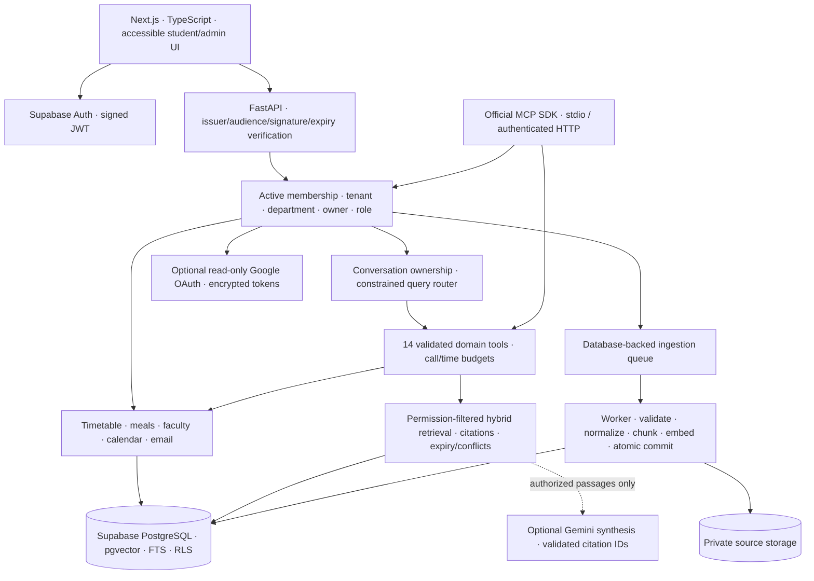

# Architecture

CampusOS is a modular monolith. Next.js is the presentation layer; FastAPI owns authorization, business rules and data access. The worker runs the same Python package in a separate process. MCP is another authenticated adapter to the same approved tool dispatcher.

## Data model

First-class relational tables: institutions, memberships, sources, documents, document_chunks, conversations, messages, ingestion_jobs, integration_connections, query_traces, audit_logs and rate_buckets.

`campus_records` stores Pydantic-validated version-one payloads for faculty, timetable entries, date exceptions, canteen items, events/exams/deadlines and authorized emails. Tenant, kind, natural key, owner, department and source are indexed relational columns. This keeps inconsistent input formats manageable while providing parameterized SQL filtering. Faculty codes join timetable records within the authorized tenant. Natural keys deduplicate/upsert structured records. This is an explicit vertical-slice tradeoff, not a claim that all academic entities already have dedicated normalized tables.

Campus, department, program, semester, section, course and classroom identifiers currently appear in validated domain payloads/memberships. Full administration and referential lifecycle management for these entities is future work. Supabase Auth owns users/passwords; memberships assign campus roles independently of client-supplied identity or JWT user metadata.

## Boundaries

1. Verify RS256/ES256 JWT signature using the configured issuer's JWKS, plus issuer, audience, expiry and subject UUID.
2. Resolve active membership from the verified subject and requested tenant. A header chooses among memberships; it never grants one.
3. Apply tenant, department and private-owner predicates before queries and retrieval. Institution/platform admins remain tenant-bound, and cannot read another owner's private email/calendar.
4. Set transaction-local database identity. PostgreSQL RLS independently restricts the `campus_api` role.
5. Validate every tool input with Pydantic and call fixed service methods. No generated SQL, shell commands or Python execution exists.
6. Cite sources after checking source access. Download originals through an authenticated API route as attachments.

## Retrieval

Chunks preserve page number, document version, publication/expiry, topic/claim and original source. Embeddings always have 384 dimensions. Default embeddings are deterministic lexical hashing; they are not presented as semantic intelligence. An operator can install sentence-transformers and supply a pre-downloaded local 384-dimensional model directory. The application never downloads a model implicitly.

PostgreSQL retrieves bounded pgvector cosine candidates plus full-text candidates, then reranks by lexical/cosine signals. SQLite uses the same permission-filtered corpus with local ranking. Similarity is a ranking signal, not a confidence probability. Changing models requires re-indexing; mixed-model vectors are not compared. A model fingerprint includes its configured directory name; deployments must not replace model contents in place without re-indexing.

Conflict detection compares **recorded claims for a shared topic**, retaining unresolved alternatives. Explicit supersession is recognized. Arbitrary natural-language contradiction detection is not implemented. Expired documents are excluded unless explicitly requested.

Gemini can summarize already-authorized passages. Its output must match a schema and cite only supplied source IDs. Failures fall back to extractive passages. This validates provenance, not the factual truth of every generated sentence. Source content never controls tool selection or execution.

## Ingestion and jobs

Files are bounded, checksummed and stored privately. Structured preview detects columns, accepts mapping and reports row-level validation. Confirmation queues a job. The worker claims with `FOR UPDATE SKIP LOCKED` on PostgreSQL, rechecks the uploader's current membership, and commits domain changes plus job completion atomically. Processing rows are locked during extraction/indexing. A ten-minute claim lease permits recovery from a dead worker. Failed parsing preserves prior institutional records.

An unchanged upload by the same user/kind returns its existing job. Structured natural keys avoid duplicate records across different file versions. Documents retain source/version lineage. Re-indexing replaces the same document's chunks. Large PDFs are extracted in the worker; preview shows metadata before confirmation. Local development should run one SQLite worker.

## Operations

API logs contain request ID, method, status and latency, without query strings or content. Traces contain route/tool names and timings, without question text. Conversation bodies are private persisted data, not application logs. Rate limiting uses atomic database upserts and is shared across API processes. Background processing and Gemini/Google requests use bounded inputs and timeouts. The between-tool execution budget is not an operating-system hard timeout for one expensive parse; use process/container resource limits in production.
